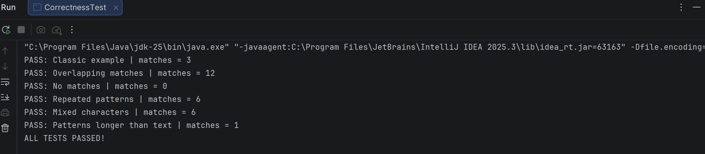
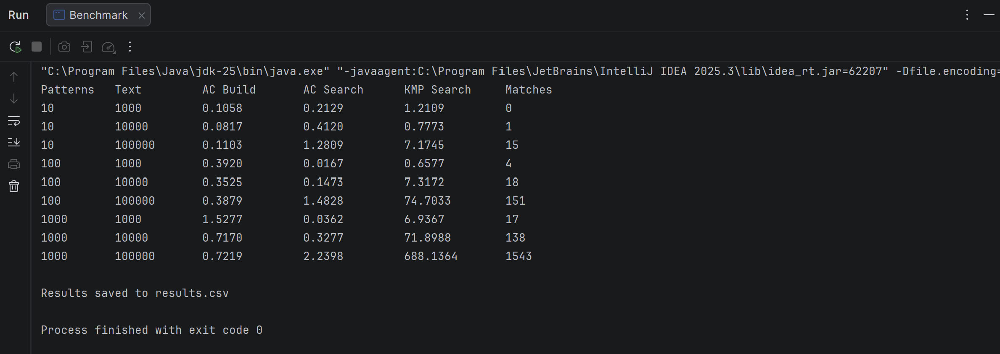

# Aho–Corasick Algorithm — DAA Bonus Assignment

*Name:AIDANA MURATOVA SE-2539*

## 1. Introduction

This project was developed as a bonus assignment for the Design and Analysis of Algorithms (DAA) course. The main goal is to implement the Aho–Corasick algorithm in Java, test its correctness, measure its execution time, and compare its performance with the Knuth–Morris–Pratt (KMP) algorithm.

String matching is a common problem in computer science. It is used in text editors, search engines, DNA sequence analysis, and many other applications. When we need to find only one pattern in a text, algorithms such as KMP can solve the problem efficiently. However, when we need to search for hundreds or thousands of patterns, running KMP separately for every pattern requires repeated scans of the same text.

Aho–Corasick solves this problem by combining all patterns into one data structure and searching for them simultaneously.

In this project, I implemented both Aho–Corasick and KMP, created correctness tests, and conducted experiments using different numbers of patterns and text lengths.

## 2. Project Objectives

The main objectives of this assignment are:

1. Implement the Aho–Corasick algorithm in Java.
2. Construct a Trie to store multiple patterns.
3. Build failure links using Breadth-First Search (BFS).
4. Implement output links to detect all matching patterns.
5. Find all occurrences of patterns in a given text, including overlapping matches.
6. Test the implementation with 10, 100, and 1000 patterns.
7. Test text lengths of 1000, 10000, and 100000 characters.
8. Measure execution time using System.nanoTime().
9. Repeat each experiment five times and calculate the average execution time.
10. Analyze time and space complexity.
11. Compare Aho–Corasick with running KMP separately for each pattern.

## 3. How the Aho–Corasick Algorithm Works

Aho–Corasick is a string-matching algorithm designed to search for multiple patterns in a single text.

The algorithm has three main parts: Trie construction, failure link construction, and searching with output links.

### 3.1 Trie Construction

The first step is to build a Trie, also called a prefix tree.

A Trie stores strings character by character. Each node represents a prefix, and each edge represents a character. If several patterns share the same prefix, they also share the corresponding nodes.

For example, consider these patterns:

he, her, hers, his

All four patterns begin with the character `h`, so they share the first node. The patterns `he`, `her`, and `hers` also share the prefix `he`.

This reduces repeated storage of common prefixes.

In my implementation, each Trie node contains:

- next — a HashMap storing transitions to the next nodes.
- fail — a failure link used when a character does not match.
- outputLink — a link to another node that represents a completed pattern.
- patternIds — a list containing the IDs of patterns ending at the node.

The addPattern() method inserts patterns into the Trie. When the last character of a pattern is reached, its ID is stored in the corresponding node.

### 3.2 Failure Link Construction

After building the Trie, the next step is to construct failure links.

Failure links are important because they allow the algorithm to continue searching without restarting from the beginning whenever a mismatch occurs.

A failure link points to the node representing the longest proper suffix of the current node's string that is also a prefix of one or more patterns.

For example, if the algorithm cannot continue matching the current pattern, it follows the failure link to another useful state instead of discarding all previously matched information.

This idea is similar to the LPS array used in KMP.

In my Java implementation, failure links are constructed using Breadth-First Search (BFS).

The root node points to itself. The direct children of the root have failure links pointing to the root. For the remaining nodes, the algorithm follows the failure links of their parent nodes until it finds a suitable transition or reaches the root.

The `build()` method performs this process using a queue.

### 3.3 Output Links

Failure links help the algorithm continue searching, but output links are needed to report all matching patterns.

Sometimes multiple patterns end at the same position in the text.

For example:

Patterns: he, she

Text: she

The algorithm must find both patterns:

- she starts at index 0.
- he starts at index 1.

If the algorithm only reported the current Trie node, it could miss shorter patterns that are suffixes of longer matches.

Output links solve this problem by connecting a node to another terminal node along its failure-link chain.

In my implementation, the outputLink field is used to find these additional matches.

### 3.4 Searching for Patterns

After constructing the Trie and its links, the algorithm can search the text.

The text is processed character by character from left to right.

For every character, the algorithm tries to follow the corresponding Trie transition. If the transition does not exist, it follows failure links until a suitable transition is found or the root is reached.

Whenever the current node represents the end of a pattern, the algorithm records the occurrence.

It also follows output links to report other patterns ending at the same position.

The search() method returns the pattern ID, starting index, and ending index of each occurrence.

The countMatches() method performs the same matching process but only counts occurrences. This method is used in the performance experiments to avoid the additional cost of storing all match objects.

## 4. Example of the Algorithm

The implementation was tested using a classic Aho–Corasick example.

**Patterns:**

he, she, his, hers

**Text:**

ushers

The program produces the following results:

| Pattern | Start Index | End Index |
|---|---:|---:|
| she | 1 | 3 |
| he | 2 | 3 |
| hers | 2 | 5 |

Total matches: **3**

The example demonstrates that the algorithm can detect different patterns in the same text, including patterns that overlap.

The indexes are zero-based, meaning the first character has index 0.

## 5. Java Project Structure

The project contains five Java classes and one CSV file with experimental results.

| File | Description |
|---|---|
| `AhoCorasick.java` | Main implementation of the Trie, failure links, output links, and pattern searching |
| `KMPSearch.java` | KMP implementation used for comparison |
| `CorrectnessTest.java` | Tests correctness by comparing Aho–Corasick results with KMP |
| `Benchmark.java` | Generates test data and measures execution time |
| `Main.java` | Demonstrates the algorithm using a simple example |
| `results.csv` | Stores the experimental results |

The implementation uses standard Java libraries, including HashMap, ArrayList, ArrayDeque, and Queue.

No external dependencies are required.

## 6. Correctness Testing

Before measuring performance, I tested the implementation to make sure it finds patterns correctly.

Six different test cases were used.

| Test Case | Description                                         | Result |
|---|-----------------------------------------------------|---|
| Classic example | Searches for he, she, his, and hers in ushers       | PASS |
| Overlapping matches | Searches for a, aa, and aaa in aaaaa                | PASS |
| No matches | Checks a text containing none of the patterns       | PASS |
| Repeated patterns | Tests repeated patterns in banana                   | PASS |
| Mixed characters | Tests uppercase letters, lowercase letters, numbers, and punctuation | PASS |
| Patterns longer than text | Checks that patterns longer than the text are handled correctly | PASS |

The correctness tests compare the starting positions found by Aho–Corasick with the positions returned by KMP.

All six tests passed.

The program output was:


### Correctness Test Screenshot

The following screenshot shows that all six correctness tests passed successfully.




These results show that the implementation handles the tested cases correctly, including overlapping and repeated patterns.

## 7. Experimental Methodology

The next part of the assignment was to evaluate the performance of Aho–Corasick and compare it with KMP.

### 7.1 Test Configurations

Three different numbers of patterns were used:

- 10 patterns
- 100 patterns
- 1000 patterns

Three different text lengths were tested:

- 1000 characters
- 10000 characters
- 100000 characters

This produced nine different experimental configurations.

### 7.2 Test Data Generation

The test data was generated automatically in Java using the Random class.

The alphabet contained four characters:

a, b, c, d

Each generated pattern contained eight characters.

A fixed random seed was used to make the experiments reproducible. A LinkedHashSet ensured that generated patterns were unique within each experiment.

Both algorithms received the same text and the same patterns for each configuration.

This was important because the comparison would not be fair if the algorithms processed different input data.

### 7.3 Measuring Execution Time

Execution time was measured using:

System.nanoTime()

Each experiment was executed five times.

The average execution time was calculated using:

Average Time = Sum of Execution Times / 5

The results were converted from nanoseconds to milliseconds.

Before collecting measurements, the benchmark performed three warm-up runs for each configuration to reduce the influence of JVM startup and initial JIT compilation.

For Aho–Corasick, I measured two parts separately:

1. **AC Build:** Time required to construct the Trie, failure links, and output links.
2. **AC Search:** Time required to search the text using the constructed automaton.

For KMP, the measured search time includes constructing the LPS array for each pattern and searching the text separately.

The number of matches returned by both algorithms was compared during every experiment. If the counts were different, the benchmark would stop with an error.

The measurements were saved in `results.csv`.

## 8. Experimental Results

The following table contains the average execution times from five runs for each configuration.

All execution times are measured in milliseconds (ms).

| Patterns | Text Length | AC Build (ms) | AC Search (ms) | KMP Search (ms) | Matches |
|---|---:|---:|---:|---:|---:|
| 10 | 1,000 | 0.1601 | 0.3079 | 1.5548 | 0 |
| 10 | 10,000 | 0.0657 | 0.3723 | 0.8852 | 1 |
| 10 | 100,000 | 0.1447 | 1.4176 | 8.3472 | 15 |
| 100 | 1,000 | 0.6010 | 0.0217 | 0.9599 | 4 |
| 100 | 10,000 | 0.4537 | 0.2214 | 9.1594 | 18 |
| 100 | 100,000 | 0.4038 | 1.6098 | 79.8782 | 151 |
| 1,000 | 1,000 | 0.9634 | 0.0303 | 6.7193 | 17 |
| 1,000 | 10,000 | 0.5976 | 0.2407 | 70.6573 | 138 |
| 1,000 | 100,000 | 0.6367 | 2.5016 | 704.4125 | 1,543 |


### Benchmark Screenshot

The following screenshot shows the measured execution times for all nine experimental configurations.




## 9. Analysis of Experimental Results

The experimental results show that Aho–Corasick performs particularly well when the number of patterns increases.

### 9.1 Performance with 10 Patterns

When only 10 patterns were used, the difference between the algorithms was relatively small.

For a text of 1000 characters, Aho–Corasick required approximately 0.4680 ms including construction, while KMP required 1.5548 ms.

For a text of 100000 characters, the total Aho–Corasick time was approximately 1.5623 ms, compared with 8.3472 ms for KMP.

These results show that Aho–Corasick can still perform well with a small number of patterns. However, the advantage is less significant than with larger pattern sets.

### 9.2 Performance with 100 Patterns

With 100 patterns, the performance difference became more noticeable.

For a text of 100000 characters:

- Aho–Corasick build time: 0.4038 ms
- Aho–Corasick search time: 1.6098 ms
- Aho–Corasick total time: 2.0136 ms
- KMP search time: 79.8782 ms

In this configuration, Aho–Corasick was approximately 39.7 times faster when its construction and search times were combined.

The main reason is that Aho–Corasick searches for all 100 patterns simultaneously, while KMP performs a separate search for every pattern.

### 9.3 Performance with 1000 Patterns

The largest difference appeared when searching for 1000 patterns.

For a text of 100000 characters:

- Aho–Corasick build time: 0.6367 ms
- Aho–Corasick search time: 2.5016 ms
- Aho–Corasick total time: 3.1383 ms
- KMP search time: 704.4125 ms

In this experiment, Aho–Corasick was approximately 224.5 times faster, even after including the construction time.

This result demonstrates why Aho–Corasick is useful for applications that need to search for many patterns in a large text.

### 9.4 General Observations

Several observations can be made from the experiments.

First, the execution time of KMP increased significantly as the number of patterns increased. This is expected because KMP scans the text separately for each pattern.

Second, the Aho–Corasick search time depended mainly on the text length, the automaton transitions, and the number of matches. Increasing the number of patterns did not cause the same proportional increase in search time as KMP.

Third, Aho–Corasick required additional time to construct the automaton. However, this preprocessing cost became relatively small compared with the cost of repeatedly scanning a large text using KMP.

Finally, some small timing differences were not perfectly consistent. This is normal in Java benchmarks because execution times can be affected by JVM optimizations, garbage collection, JIT compilation, and other processes running on the computer.

For this reason, the results should be understood as measurements from this experimental setup rather than exact performance guarantees.

## 10. Time Complexity Analysis

Let:

- n be the length of the text.
- k be the number of patterns.
- L be the total length of all patterns.
- z be the total number of matches.
- V be the number of Trie nodes.

### 10.1 Aho–Corasick Time Complexity

**Trie construction: O(L)**

Every character of every pattern is inserted into the Trie. With expected constant-time HashMap operations, construction takes O(L) time.

**Failure and output link construction: O(L) expected**

Failure links are constructed using BFS. Each Trie node is processed once, and failure transitions reuse information from previously processed nodes.

For a fixed alphabet with expected constant-time transitions, the total preprocessing time is O(L).

**Searching: O(n + z) expected**

The algorithm processes the text in one pass. Failure links avoid restarting the search, and output links allow matching patterns to be reported.

The total search time depends on the text length and the number of reported matches.

Therefore, the overall expected complexity is:

**O(L + n + z)**

### 10.2 KMP Time Complexity

KMP uses the LPS array to avoid unnecessary comparisons when searching for one pattern.

For one pattern of length m:

- LPS construction: O(m)
- Searching: O(n)

Total: O(n + m)

However, when searching for k patterns separately, the text must be scanned for every pattern.

The total complexity becomes:

**O(L + kn)**

This explains why KMP becomes more expensive when the number of patterns increases.

## 11. Space Complexity Analysis

### 11.1 Aho–Corasick

The Trie contains at most O(L) nodes because each inserted character creates at most one new node.

Each node stores transitions, a failure link, an output link, and a list of pattern IDs ending at that node.

The implementation uses a HashMap for transitions, so it does not allocate a complete fixed-size alphabet array for every node.

The expected storage required for the automaton and patterns is:

**O(L + V)**

Since V is at most L + 1, this can also be expressed as O(L).

The search() method additionally stores the reported occurrences, requiring O(z) memory.

The countMatches() method avoids storing occurrences and uses only constant additional space during the scan.

### 11.2 KMP

KMP uses an LPS array whose size depends on the pattern length.

For one pattern of length m, the auxiliary space complexity is:

**O(m)**

When patterns are processed one after another, the LPS array can be created separately for each pattern.

This means KMP generally requires less additional memory than Aho–Corasick for a single-pattern search.

## 12. Aho–Corasick vs KMP

Both algorithms are efficient string-matching methods, but they are designed for different situations.

| Feature | Aho–Corasick | KMP |
|---|---|---|
| Main purpose | Multiple-pattern matching | Single-pattern matching |
| Data structure | Trie with failure and output links | LPS array |
| Preprocessing | O(L) expected | O(m) per pattern |
| Search time | O(n + z) expected | O(n) per pattern |
| Multiple-pattern search | One scan of the text | One scan per pattern |
| Memory | Higher due to the automaton | Lower for one pattern |
| Implementation | More complex | Simpler |
| Best use case | Many patterns in the same text | One or a few patterns |

### Advantages of Aho–Corasick

Aho–Corasick is efficient when many patterns must be searched simultaneously. It avoids repeatedly scanning the same text and supports overlapping matches.

It is particularly useful in keyword filtering, intrusion detection, DNA analysis, and applications involving large dictionaries of patterns.

Another advantage is that the same constructed automaton can be reused for multiple texts without rebuilding it, provided the pattern set does not change.

### Limitations of Aho–Corasick

Aho–Corasick is more complicated to implement than KMP.

It also requires additional memory for Trie nodes, transitions, failure links, and output links.

The automaton must be constructed before searching, which introduces preprocessing overhead.

For a single pattern or a very small pattern set, this extra work may not always be worthwhile.

### Advantages of KMP

KMP is simpler to understand and implement.

It provides deterministic linear-time matching for one pattern and requires only an LPS array.

It is a good choice when only one pattern needs to be searched or when memory usage is important.

### Limitations of KMP

KMP is not designed to search many patterns simultaneously.

When searching for hundreds or thousands of patterns, the algorithm must scan the text separately for each pattern.

As a result, its total execution time grows with the number of patterns.

## 13. Running the Project

The project was implemented in Java and can be executed in IntelliJ IDEA or from the command line.

### Requirements

- Java JDK 17 or newer
- IntelliJ IDEA or another Java-compatible IDE

The experiments provided in this report were executed using JDK 25.

### Running in IntelliJ IDEA

1. Open the project in IntelliJ IDEA.
2. Open the src folder.
3. Run Main.java to see the example.
4. Run CorrectnessTest.java to verify correctness.
5. Run Benchmark.java to measure execution time.

### Running from the Command Line

Compile the Java source files:

```bash
javac -d out src/*.java
```

Run the example:

```bash
java -cp out Main
```

Run the correctness tests:

```bash
java -cp out CorrectnessTest
```

Run the performance experiments:

```bash
java -cp out Benchmark
```

After running the benchmark, the results are saved to `results.csv` in the current working directory.

## 14. Conclusion

This assignment helped me understand how Aho–Corasick can be used to search for multiple patterns efficiently.

The implementation combines a Trie, failure links, and output links to find all occurrences without repeatedly starting the search from the beginning.

The correctness tests confirmed that the implementation handles the tested cases, including overlapping patterns and repeated occurrences.

The performance experiments showed a clear advantage for Aho–Corasick when the number of patterns increased. In the largest experiment, with 1000 patterns and a text of 100000 characters, Aho–Corasick was approximately 224.5 times faster than running KMP separately.

At the same time, the comparison showed that KMP remains useful for simpler single-pattern searches because it requires less memory and has a simpler implementation.

Overall, the project demonstrates that choosing the right string-matching algorithm depends on the number of patterns, the text length, and the available memory.

## 15. References

1. DAA Lecture — *String Algorithms I: Knuth–Morris–Pratt and Polynomial Rolling Hashing*.
2. DAA Lecture — *String Algorithms II: Suffix Arrays, LCP (Kasai) and Aho–Corasick*.
3. Aho, A. V., and Corasick, M. J. (1975). *Efficient String Matching: An Aid to Bibliographic Search*. Communications of the ACM, 18(6), 333–340.
4. Knuth, D. E., Morris, J. H., and Pratt, V. R. (1977). *Fast Pattern Matching in Strings*. SIAM Journal on Computing, 6(2), 323–350.